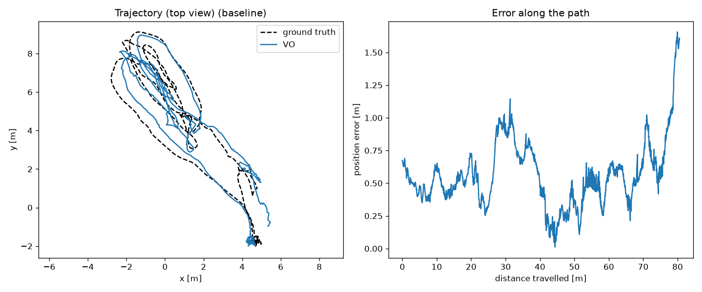
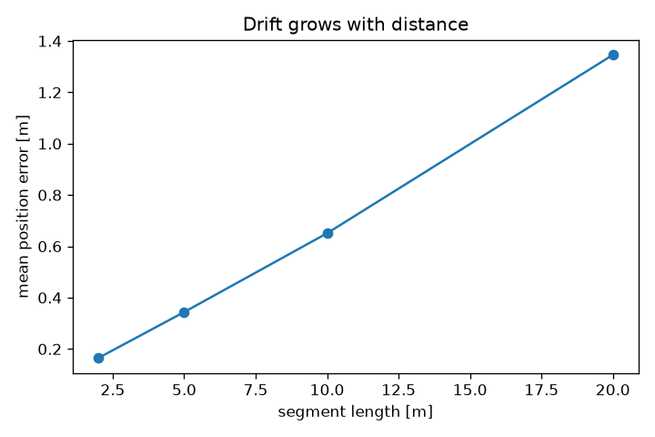
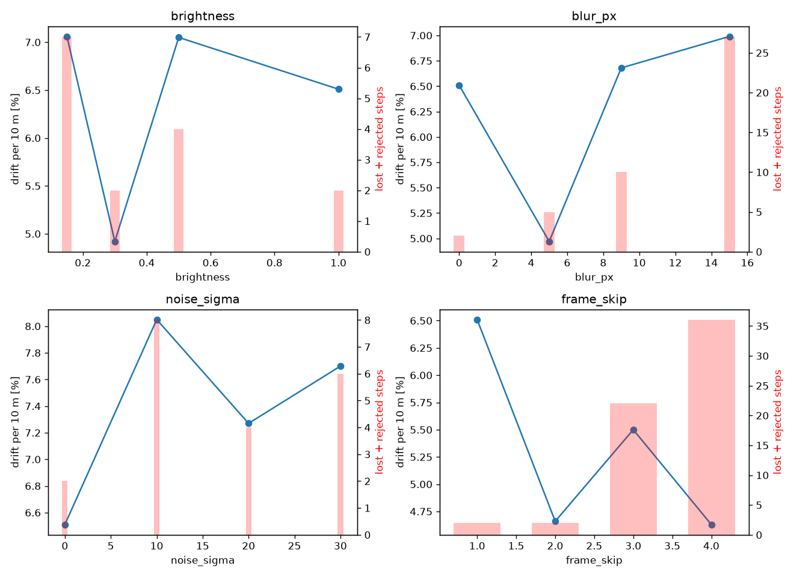

# Visual Odometry Drift Test

How fast does a camera-only position estimate drift, and what makes it worse?
Context: navigation for drones where GPS is unavailable.

## What I built

- `vo/mono_vo.py`: monocular visual odometry. Shi-Tomasi corners, KLT optical-flow tracking,
  essential matrix with RANSAC, keyframes after 10 px of image motion, and a sanity check that
  rejects steps with few inliers or implausible rotation. Scale is taken from ground truth
  ("oracle scale"), so the measured drift is rotation and direction drift.
- `eval/evaluate.py`: metrics with [evo](https://github.com/MichaelGrupp/evo). ATE (after SE3
  alignment), drift % = mean translation error over 2/5/10/20 m segments ÷ segment length,
  heading drift in degrees per 10 m.
- `run_experiments.py`: the same sequence clean and degraded (brightness, blur, noise, frame
  rate), producing `results/summary.csv` and charts.
- `tools/make_synth.py`: a synthetic downward-camera flight with exact ground truth, over ground
  with raised blocks or perfectly flat ground.

## Data

- EuRoC MAV, Machine Hall 01 (drone, 20 Hz camera, motion-capture ground truth)
- Synthetic: 24 m arc at 5 m height, camera pointing down

## Results

| Sequence | Path (m) | ATE RMSE (m) | Drift per 10 m | Heading (deg/10 m) |
|---|---|---|---|---|
| EuRoC MH_01 | 80.5 | 0.61 | 6.5% | 6.0 |
| Synthetic, ground with blocks | 24.3 | 0.19 | 3.3% | 2.8 |
| Synthetic, flat ground | 24.3 | 3.41 | 53.7% | 54.4 |




### Stress tests (EuRoC MH_01)

| Condition | ATE (m) | Drift per 2 m | Drift per 10 m | Lost / rejected steps |
|---|---|---|---|---|
| Clean | 0.61 | 8.3% | 6.5% | 0 / 2 |
| Brightness 50% / 30% / 15% | 1.19 / 0.83 / 1.09 | 9.0 / 9.0 / 11.1% | 7.1 / 4.9 / 7.1% | 0 / 2–7 |
| Blur 5 / 9 / 15 px | 0.76 / 0.58 / 0.83 | 8.6 / 9.8 / 11.5% | 5.0 / 6.7 / 7.0% | 0–3 / 5–24 |
| Noise σ 10 / 20 / 30 | 0.98 / 0.86 / 1.44 | 11.5 / 10.6 / 12.0% | 8.1 / 7.3 / 7.7% | 0 / 4–8 |
| Every 2nd / 3rd / 4th frame | 0.83 / 0.42 / 0.82 | 9.3 / 7.6 / 8.3% | 4.7 / 5.5 / 4.6% | 0–4 / 2–32 |



## Findings

1. **Drift grows linearly with distance.** Drift stays at 6.5–8% whether it is measured over
   2 m or 20 m, so the error keeps adding about 0.65 m per 10 m flown. Over 1 km without GPS
   that is tens of metres from VO alone, which is why VO needs a correction source (IMU, map or
   satellite-image matching).
2. **Flat ground is the worst case for a downward camera.** Over a perfectly flat scene the
   essential matrix has two valid solutions, and the VO picks the wrong one often enough that
   drift went from about 3% to about 55% per 10 m (repeatable across runs). A real system
   needs homography-based estimation for planar scenes, or an IMU to break the ambiguity.
3. **Image noise hurts the most.** It raised short-range drift the most (8% → 12% per 2 m)
   and more than doubled ATE at σ=30 (0.61 → 1.44 m). Noise moves the corners that KLT tracks,
   so every step gets a little less accurate.
4. **Blur and frame drops cost robustness before accuracy.** Drift per 10 m barely changed,
   but lost and rejected steps rose from 2 to 24 (heavy blur) and 32 (every 4th frame): the
   system is closer to losing track. Fewer frames even lowered drift slightly (6.5% → 4.7%),
   because fewer, longer steps chain fewer small errors, until tracking starts to break.
5. **Darkening alone did little.** KLT and corner detection are nearly unaffected by scaling
   brightness. Real low light is different: it adds sensor noise and motion blur (longer
   exposure), and finding 3 suggests noise is the part that hurts.

Differences under about 2 percentage points are within run-to-run variation (one run per
condition), so only the trends above should be read from the table.

## Lessons from debugging

- EuRoC ground truth is the body (IMU) pose, not the camera's: the camera poses must be
  converted with the camera-to-body transform (`T_BS`) before relative errors mean anything.
- OpenCV's `recoverPose` drops points farther than 50 step lengths by default. In a large hall
  with small steps that discarded most points and rejected 2/3 of all good estimates.

## Limitations

- Oracle scale: a real monocular system must estimate scale (IMU, altimeter, stereo).
- One sequence and one run per condition; the noise results vary from run to run.
- No loop closure or IMU fusion: this measures raw VO drift on purpose.

## Next steps

- Fuse the IMU gyro for rotation (removes most heading drift)
- Homography / plane-aware motion estimation for downward cameras over flat terrain
- Correct drift by matching against a map or satellite imagery
- Compare against OpenVINS / ORB-SLAM3 on the same sequences

## Reproduce

```bash
pip install -r requirements.txt
python tools/make_synth.py data/synth
python run_experiments.py data/euroc/MH_01_easy/mav0 --out results
```
